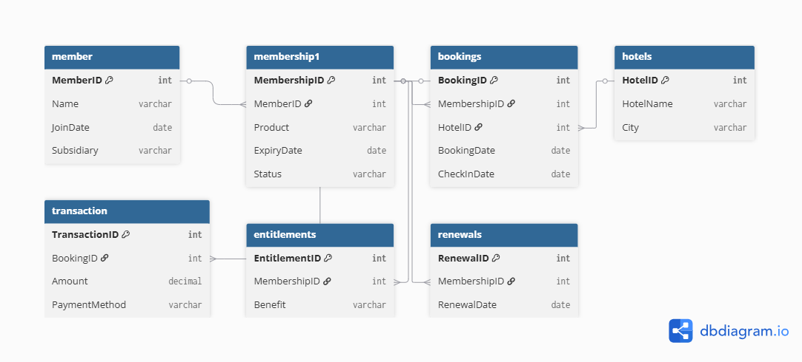

# 🗄️ Documentation

This folder contains supporting documentation and database design resources for the **Hotel Membership & Booking Analysis** project.

---

## 📌 Entity Relationship Diagram

The Entity Relationship Diagram (ERD) represents the structure of the relational database and shows how the different tables are connected.



---

## 🗂️ Tables Represented

The database contains the following tables:

- `member`
- `membership1`
- `bookings`
- `hotels`
- `transaction`
- `entitlements`
- `renewals`

---

## 🔗 Key Relationships

The major relationships between the tables are based on the following keys:

| Parent Table | Key | Related Table | Key |
|---|---|---|---|
| `member` | `MemberID` | `membership1` | `MemberID` |
| `membership1` | `MembershipID` | `bookings` | `MembershipID` |
| `hotels` | `HotelID` | `bookings` | `HotelID` |
| `bookings` | `BookingID` | `transaction` | `BookingID` |
| `membership1` | `MembershipID` | `entitlements` | `MembershipID` |
| `membership1` | `MembershipID` | `renewals` | `MembershipID` |

---

## 🧩 Data Model Overview

The overall data flow can be summarized as:

```text
Member
   │
   │ MemberID
   ▼
Membership
   │
   ├──────────────► Entitlements
   │
   ├──────────────► Renewals
   │
   │ MembershipID
   ▼
Bookings
   │
   ├──────────────► Hotels
   │
   │ BookingID
   ▼
Transaction
```

---

## 🎯 Purpose of the ER Diagram

The ER Diagram helps to:

- Understand the database structure.
- Identify relationships between tables.
- Understand primary and foreign key connections.
- Support SQL query development.
- Build the Power BI data model.
- Improve data analysis and interpretation.

---

## 🛠️ Created Using

The Entity Relationship Diagram was created using:

**dbdiagram.io**

The diagram was designed based on the structure of the CSV dataset and the relationships used during SQL and Power BI analysis.

---

## 📌 Project Usage

The ER Diagram serves as a reference for understanding the relational structure of the **Hotel Membership & Booking Analysis** project.

It supports both:

- SQL-based data analysis
- Power BI data modeling